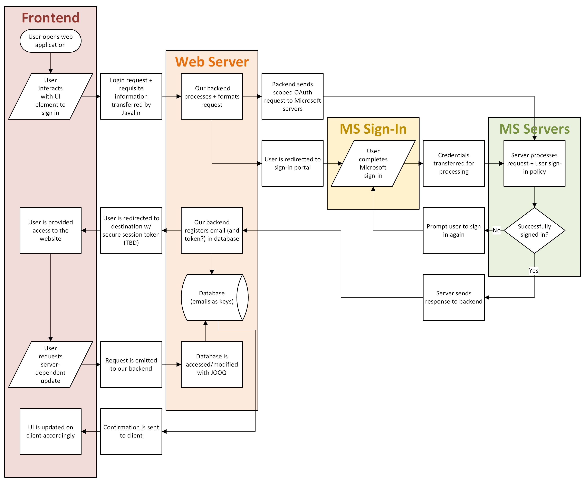

# GHGryphon
A web application allowing L&amp;N students and staff to view, choose, and manage genius hour clubs.

## Backend Setup
### Prerequisites:
- Java 25 <span style="font-size: smaller;">(required for LTS)</span>
- Gradle 9.8.2
### Frameworks (Managed by Gradle):
- Javalin - Web framework  
- Ebean - Implements SQL
- Jackson Databind - Converts between Java objects & JSON
- SLF4J Simple - Javalin logger
- JUnit Jupiter - Testing framework

_Version information and other specifics are available in the Gradle build file:_ ```backend/app/build.gradle```

#### Architecture Flowchart (WIP):
<p align="center">
  
</p>

### Functionality:
- Local H2 SQL database (users, clubs)
  - Intention: Implement PostgreSQL (remote database)
  - Intention: Add other necessary GH records & relationally link
- GET, POST, PUT, DELETE methods (users, clubs)
  - Possibility: Add PATCH method for transfer efficiency

### Instructions:
**Recommended:** Install Temurin Java 25.0.5.0+8 with sdkman:
```sdk install java 25.0.5.0+8-tem``` <span style="font-size: smaller;">(other Java 25 builds should work as well)</span>

Install Gradle <span style="font-size: smaller;">(automatically handles dependencies)</span>: ```sdk install gradle```

Run backend: Ensure you are in the backend directory and run ```./gradew run```